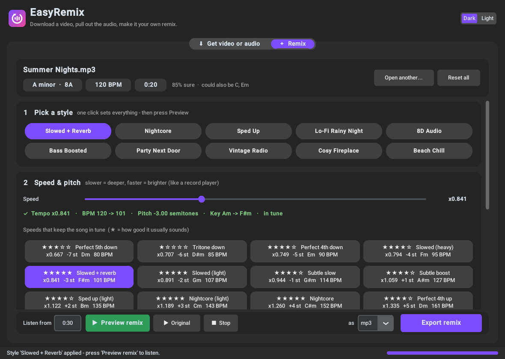

# EasyRemix



A friendly app for Windows, Linux and Android with two tabs:

1. **Get video or audio**: paste a link (YouTube, TikTok, Instagram, VK, X and 1000+ other
   sites) or pick a file, then choose **Full video**, **Audio only** (mp3, wav, flac, m4a, ogg)
   or **Remix it** (the sound goes straight into the Remix tab).
   **Send to...** shares the video itself with friends (Telegram, WhatsApp, VK, Facebook ...)
   without keeping a copy in your files:
   - on Android it opens the phone's share sheet, so every installed app is offered;
   - on the desktop the video is downloaded to a temporary folder and copied to the clipboard,
     the messenger opens, and Ctrl+V in a chat sends it. Temporary copies are deleted
     automatically after a few hours.
2. **Remix** a track:
   - **Key & BPM detection**, including the Camelot code DJs use (e.g. `8A` = A minor)
   - **Speed up / slow down**, either classic (pitch changes too, like a record player: *slowed*, *nightcore*) or time-stretch (tempo only)
   - **Best speeds**: one-tap buttons for every speed that moves the song a whole number of semitones, so it stays in tune, with the new key, new BPM, a star rating and a short explanation
   - **10-band equalizer** with 16 presets (Bass Boost, Vocal, Lo-Fi, Party next door, Telephone, ...)
   - **Effects**: reverb, echo, chorus, lo-fi/bitcrush, distortion, 8D rotation
   - **Ambience layers**: rain, vinyl crackle, tape hiss, ocean waves, wind, fireplace. These sounds are generated in code, so they are royalty-free
   - **Volume**, loudness normalize, fade in/out, and a built-in limiter so the output never clips
   - **One-click presets**: Slowed + Reverb, Nightcore, Lo-Fi Rainy Night, 8D Audio, Bass Boosted, ...
   - **Preview** any 25-second part before you export

The program is one folder with nothing else to install:

```
EasyRemix\
  EasyRemix.exe      <- double-click this
  _internal\         <- libraries, ffmpeg, deno (keep it next to the exe)
```

Because nothing has to be unpacked at launch, the window opens in about half a second.

## Getting the program

* **From GitHub Actions:** every push runs the *Build Windows EXE* workflow. Open the run,
  download the `EasyRemix-windows` artifact, unzip it anywhere and start `EasyRemix.exe`. To publish a
  release, open *Actions → Build Windows EXE → Run workflow* and enter a version such as `0.3`.
  The workflow builds the Windows exe, the Linux app and the Android APK, creates the tag `v0.3`
  and a GitHub Release with `EasyRemix-windows.zip`, `EasyRemix-x86_64.AppImage`,
  `EasyRemix-linux-x86_64.tar.gz` and `EasyRemix-android-arm64.apk`. Pushing a `v*` tag does the same.
* **Build it yourself on Windows:** install Python 3.12 from python.org, then double-click
  `build.bat`. The result is the folder `dist\EasyRemix\`.

The folder is a few hundred MB, mostly ffmpeg and deno. To get a desktop shortcut,
right-click `EasyRemix.exe` → *Send to* → *Desktop (create shortcut)*. Move the whole folder,
never only the exe.

If Windows SmartScreen warns you, click *More info → Run anyway*. The exe is not code-signed.

Run `EasyRemix.exe --selftest` to check every built-in component. It writes
`easyremix-selftest.txt` next to the exe.

## Linux

Every release also has two Linux downloads (64-bit x86, built on Ubuntu 22.04, so they run on
Ubuntu 22.04+, Debian 12+, Fedora, Mint and other distributions from 2022 or later):

* **`EasyRemix-x86_64.AppImage`**: one file. Make it executable and start it:
  ```bash
  chmod +x EasyRemix-x86_64.AppImage
  ./EasyRemix-x86_64.AppImage
  ```
  If it says FUSE is missing, install it (`sudo apt install libfuse2` on Ubuntu/Debian) or start
  it with `./EasyRemix-x86_64.AppImage --appimage-extract-and-run`.
* **`EasyRemix-linux-x86_64.tar.gz`**: the program folder. Unpack it, run `./EasyRemix`, and
  optionally `./install.sh` to add EasyRemix to your application menu (`./install.sh --uninstall`
  removes it).

ffmpeg, deno and PortAudio (for preview playback) are included. Run `./EasyRemix --selftest`
to check every built-in component.

To build it yourself: `sudo apt install python3-tk python3-venv libportaudio2`, then run
`sh build_linux.sh`. The result is `dist/EasyRemix/` and `dist/EasyRemix-linux-x86_64.tar.gz`
(plus the AppImage if `appimagetool` is on your PATH).

## Android

`EasyRemix-android-arm64.apk` is the phone version (Android 7 or newer, 64-bit ARM, which is
practically every phone from the last years). It has the same two tabs (Get video or audio,
Remix) with a touch interface, and uses the same engine as the desktop app.

To install it, open the APK on the phone and allow installing apps from that source when
Android asks. The APK is not from the Play Store, so Android shows a warning; that is expected
for apps you install yourself.

* **Send video** downloads into the app's private cache and opens Android's share sheet;
  nothing appears in the gallery or file manager.
* Downloads, extracted audio and remixes are saved to the phone's shared folders,
  `Music/EasyRemix` (audio) and `Movies/EasyRemix` (video), so music and gallery apps find them.
* Remix effects are computed with numpy on the phone (the desktop uses pedalboard), so they
  can sound slightly different. Exporting a long song with many effects can take a minute.
* Preview plays a 25-second part, like on the desktop.

Build it yourself on Linux: install Java 17 and buildozer (see the `android-apk` job in
`.github/workflows/build.yml`), then run `sh android/build.sh`. The first build takes about an hour.

## The speed / key math

Changing playback speed by resampling shifts the pitch by

```
semitones = 12 × log2(speed)          speed = 2^(semitones / 12)
```

So only these speeds land exactly on another key:

| Shift | Speed | Feel |
|------:|------:|------|
| −1 | 0.944× | subtle slow |
| −2 | 0.891× | light *slowed* |
| −3 | 0.841× | classic *slowed + reverb* |
| −4 | 0.794× | heavy slowed |
| −5 / −7 | 0.749× / 0.667× | perfect 4th / 5th, a neighbouring key on the circle of fifths |
| +2 | 1.122× | *sped up* |
| +3 / +4 | 1.189× / 1.260× | *nightcore* |

Any other speed, for example 0.90× (−1.82 semitones), leaves the song *between* keys, 18 cents
off standard tuning. The app warns about that and suggests the nearest in-tune speed.

## Running from source

```bash
pip install -r requirements.txt
```

```bash
python app.py
```

To run the tests:

```bash
pip install pytest && pytest -q tests
```

## Project layout

| File | Purpose |
|------|---------|
| `app.py` | entry point |
| `easyremix/gui.py` | customtkinter interface |
| `easyremix/downloader.py` | yt-dlp wrapper |
| `easyremix/audio_io.py` | decode/encode/extract via the bundled ffmpeg |
| `easyremix/analysis.py` | key (Krumhansl–Kessler profiles + overtone-suppressed chroma) and BPM detection |
| `easyremix/theory.py` | keys, Camelot wheel, speed ↔ semitone math, suggestions |
| `easyremix/dsp.py` | speed/pitch, EQ, effects, ambience generators, presets |
| `EasyRemix.spec` | PyInstaller one-file build |

## Open-source components

yt-dlp (Unlicense), FFmpeg via imageio-ffmpeg (LGPL/GPL), Deno (MIT), Spotify Pedalboard and
Rubber Band (GPLv3), NumPy/SciPy (BSD), customtkinter (MIT), sounddevice/PortAudio (MIT).
Because Pedalboard is GPLv3, any distributed EasyRemix build falls under GPLv3 too.

Only download content you have the rights to use.
